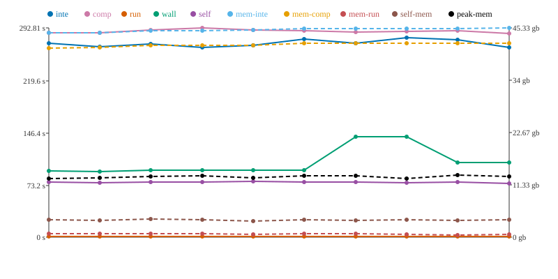

[[https://github.com/jtimon/til/raw/master/img/logo.svg]]

* Til

A programming language with ownership semantics, type inference, and compile-time
garbage collection. This is the second implementation attempt, written in C. The
first attempt in Rust lives at [[https://github.com/jtimon/rstil][rstil]].

* Motivation

There are [[https://xkcd.com/927/][too many languages]]. We need a new language that
covers everyone's use cases.

* Requirements

To replace the other languages, Til has to be:

** Free software

Some use cases require it.

** TODO Self hosted

If there's a better better language option to write its own compiler,
the language has failed: it's not good enough for the compiler use case.

** TODO Easy to learn read and write

For both humans and LLMs.

** TODO Good enough for everything

It doesn't need to be perfect for anything in particular, but good
enough to be usable for everything.

** TODO Have a REPL ([[https://en.wikipedia.org/wiki/Read%E2%80%93eval%E2%80%93print_loop][Read–eval–print loop]])

Some times you just want to calculate or check something real fast,
not even write a program.

** TODO Embedable (like Elisp/Lua)

Some use cases like dynamic configuration files (think emacs, neovim, etc)

** TODO Faster than C

May be a challange considering Til translates to C for compilation.
Not an impossible problem, just a hard one, it depends on the benchmark anyway, doesn't it?

** TODO No need for explicit delete calls (like Java or Go, unlike C)

It takes valuable thinking cycles out of programmers.

** TODO No need for a garbage collector (unlike Java and Go)

The runtime overhead and performance unpredictability of a runtime
garbage collector are simply unnaceptable for some use cases.
Til's ASAP (as soon as possible) destruction acts like a garbage
collector but at compile time, adding delete calls where they are
needed after each variable that need it's last use.
If you really want to avoid it for some reason, you can always use
malloc and free directly, and override the automatically generated
delete and clone methods with your own for any struct.

The ASAP destruction relies on keywords like own (owned pointer) or
ref (borrowed pointer) in some places.

** TODO No need for reference counters (unlike Python)

For the same reason garbage collection is not acceptable.
This is more predictable, but sill not completely deterministic. And can be more expensive.

** TODO No need for a borrow checker (unlike Rust)

** TODO ... (like Mojo)

** TODO ... (like Jai)

* Dependencies

- ~make~
- ~gcc~
- ~xvfb~ (for GUI tests)

** Optional LLVM/MLIR development tools

The experimental [[file:issues/open/317.org][MLIR backend (#317)]] uses external tools from a matching
LLVM release. These are not required for ordinary C builds, bootstrapping,
CPU SIMD through C, or ~make test~. The first MLIR subset targets Linux x86-64.

On Ubuntu 24.04, install the LLVM 18 toolchain:

#+begin_src sh
sudo apt install clang-18 llvm-18 mlir-18-tools
#+end_src

- ~mlir-18-tools~ supplies ~mlir-opt-18~ for dialect lowering and
  ~mlir-translate-18~ for translation from the LLVM dialect to LLVM IR.
- ~llvm-18~ supplies LLVM tools such as ~llc-18~ and ~llvm-config-18~.
- ~clang-18~ compiles LLVM IR and compiles/links the C interoperability tests.

Use the versioned commands to avoid mixing unrelated default toolchains:

#+begin_src sh
mlir-opt-18 --version
mlir-translate-18 --version
llvm-config-18 --version
clang-18 --version
#+end_src

The locally verified tool versions are 18.1.3 (Ubuntu package revision
~1:18.1.3-1ubuntu1~). This identifies the initial CPU prototype toolchain;
the scalar/F32x4 lowering and C ABI are covered by the opt-in integration test.
GPU toolchain
requirements will be established separately by [[file:issues/open/411.org][#411]] and [[file:issues/open/412.org][#412]].

LLVM/MLIR is an optional system dependency, not vendored. The
external-tool pipeline does not link MLIR's C++ libraries into til and does
not require ~libmlir-18-dev~. Only install these tools when working on that
backend; installing them does not select it by default.

Select ~--backend=mlir~ explicitly with ~translate~, ~build~ or ~run~;
~--target~ still selects the platform and C remains the default backend.
See [[file:doc/self.org::*Experimental MLIR backend][Experimental MLIR backend]] for the supported subset, outputs and tests.

** Optional FASM bootstrap

The experimental [[file:issues/open/453.org][FASM backend (#453)]] supports Linux x86-64.
Translation needs no assembler. Build/run use the vendored assembler, built
once with an existing FASM executable (Ubuntu/Debian package ~fasm~):

#+begin_src sh
fasm vendor/fasm/source/linux/x64/fasm.asm vendor/fasm/fasm
chmod +x vendor/fasm/fasm
bin/til run --backend=fasm path/to/program.til
bin/til run test/fasm_native.til bin/til
bin/til run test/fasm_runtime.til bin/til
#+end_src

The generated ~vendor/fasm/fasm~ is a native x86-64 executable, ignored by
git. After this initial bootstrap, ordinary ~make~ / ~make vendor~ and FASM
build/run commands rebuild it automatically when its assembly sources or
includes change. A failed rebuild leaves the previous executable intact.

On Linux x86-64, compiler installation copies a bootstrapped assembler and
its license to ~<prefix>/lib/til/vendor/fasm/~, and the runtime to
~<prefix>/lib/til/src/fasm/~. Installed compilers use these read-only payloads;
they do not rebuild the assembler or write temporary files into the installation.
Without a bootstrap, installation explicitly reports that it is installing
only the FASM runtime sources. Bootstrap and reinstall to enable native FASM
execution in that installation.

Ordinary C builds and ~make test~ do not require FASM; the suite checks translation and
diagnostics, while ~test/fasm_native.til~ and ~test/fasm_runtime.til~ check native
execution and the ~src/fasm/ext.fasm~ runtime explicitly.
See [[file:doc/self.org::*Experimental FASM backend][Experimental FASM backend]] for the supported subset.

** Cross-compilation targets

Building for non-native targets requires target-specific compilers and
sysroots. Install these packages (Ubuntu/Debian) for each target:

- ~linux-arm64~: ~gcc-aarch64-linux-gnu~
- ~linux-riscv64~: ~gcc-riscv64-linux-gnu~
- ~linux-x86~ (32-bit): ~gcc-multilib~, ~qemu-user~ (for testing)
- ~linux-arm32~: ~gcc-arm-linux-gnueabihf~, ~qemu-user~ (for testing)
- ~linux-riscv32~: No standard Ubuntu packages exist; use a Bootlin prebuilt toolchain (see CI configuration)
- ~windows-x64~ / ~windows-x86~: ~mingw-w64~ (ships both the x86_64 and i686 cross compilers), plus ~cmake~ for the vendored libraries' windows archives
- ~macos-arm64~ / ~macos-x64~: ~clang~, ~lld~, ~llvm~ -- the whole LLVM toolchain, not just clang: lld links (and ad-hoc-signs arm64) Mach-O, llvm-ar/llvm-nm build the mac gui archives and framework stubs for ~make build_mac~. No Apple SDK and no mac needed (vendored headers + .tbd stubs)
- ~std/crypto~ on any of the targets above: the program links that target's own libsecp256k1 archive, ~vendor/secp256k1/build-<target>/lib/libsecp256k1.a~ (the host's included; ~std/crypto~'s per-target ~link()~ lines name them), built with ~cmake~ and the target's compiler by ~bin/make~ and that path; ~bin/til build~ names the command when it is missing. ~wasm32~ uses ~build-wasm32~, built with the vendored emsdk's ~emcc~. ~linux-x64~ off a linux-x64 host is built with ~x86_64-linux-gnu-gcc~ or the cross gcc ~bin/make --linux-x64-cc=<path>~ (or ~LINUX_X64_CC~) names, e.g. messense's ~x86_64-unknown-linux-gnu-gcc~ on a mac
- the nng server modes (~--extra-modes=examples/custom_modes.til~) on any of the targets above except ~wasm32~: the program links that target's own nng, ~vendor/nng/build-<target>/libnng.a~, built with ~cmake~ and the target's compiler by ~bin/make~ and that path (~--riscv32-cc=~ for riscv32; the mac ones SDK-less); ~bin/til build~ names the command when it is missing
- runtime ~ext_func~ (a program calling libffi, or til itself running on that target) on any of the targets above but ~wasm32~: that target's libffi archive, ~vendor/libffi/build-<target>/.libs/libffi.a~ (the host's built by ~make~; the per-target ~link()~ lines in ~src/self/interpreter.til~ name them), the others built with the target's compiler by ~bin/make~ and that path (~--riscv32-cc=~ for riscv32, ~--linux-x64-cc=~ for linux-x64 off a linux-x64 host; the mac ones SDK-less, with the mac toolchain above); ~bin/til build~ names the command when it is missing
- ~wasm32~: every wasm32 build goes through the vendored emsdk's ~emcc~ (or ~--cc~). A program builds to a single-file ~.js~ (the wasm embedded) that ~til run~ runs with ~node~; ~mode gui~ builds a single-file ~.html~ instead
- ~wasm32~ browser GUI: ~make build_wasm~ uses the vendored emsdk tree under ~vendor/emscripten/~, installs the generated emscripten payload under ignored ~vendor/emscripten/node/~ and ~vendor/emscripten/upstream/~, and builds raylib-web

* Internal dependencies (bundled in the repository)

- [[https://github.com/libffi/libffi][libffi]]
- [[https://github.com/emscripten-core/emsdk][emsdk]]
- [[https://github.com/raysan5/raylib][raylib]]
- [[https://sourceforge.net/projects/tinyfiledialogs/][tinyfiledialogs]]
- [[https://github.com/nanomsg/nng][nng]]
- [[https://github.com/bitcoin-core/secp256k1][libsecp256k1]] (v0.8.0, for ~std/crypto~)
- [[https://github.com/tgrysztar/fasm][flat assembler]] (optional native assembly backend)

Bundled internal dependency licenses:

- ~vendor/fasm/~ -- [[file:LICENSE/fasm.txt]] (upstream license, also retained in ~vendor/fasm/LICENSE.TXT~)

- project: [[file:LICENSE/MIT.txt]] (MIT License)
- ~vendor/emscripten/~ — [[file:LICENSE/emscripten.txt]]
- ~vendor/libffi/~ — [[file:LICENSE/libffi.txt]]
- ~vendor/raylib/~ — [[file:LICENSE/raylib.txt]]
- ~vendor/tinyfiledialogs/~ — [[file:LICENSE/tinyfiledialogs.txt]]
- ~vendor/nng/~ — [[file:LICENSE/nng.txt]]
- ~vendor/secp256k1/~ — [[file:LICENSE/secp256k1.txt]]
- Unicode property/conformance data: [[file:LICENSE/unicode.txt]] (Unicode License v3,
  permissive; requires retaining the notice, not copyleft).

* Usage

** Build

~bin/til_boot~ is built entirely from the last commit (via git).
~bin/til~ is built from all current sources (.til and C). The
self-hosting bootstrap does not constrain commit structure.

#+begin_src sh
make
#+end_src

** Run

Interpret a program:
#+begin_src sh
bin/til interpret program.til
#+end_src

Compile to C and run:
#+begin_src sh
bin/til run program.til
#+end_src

** Test

#+begin_src sh
make test
#+end_src

* Performance

